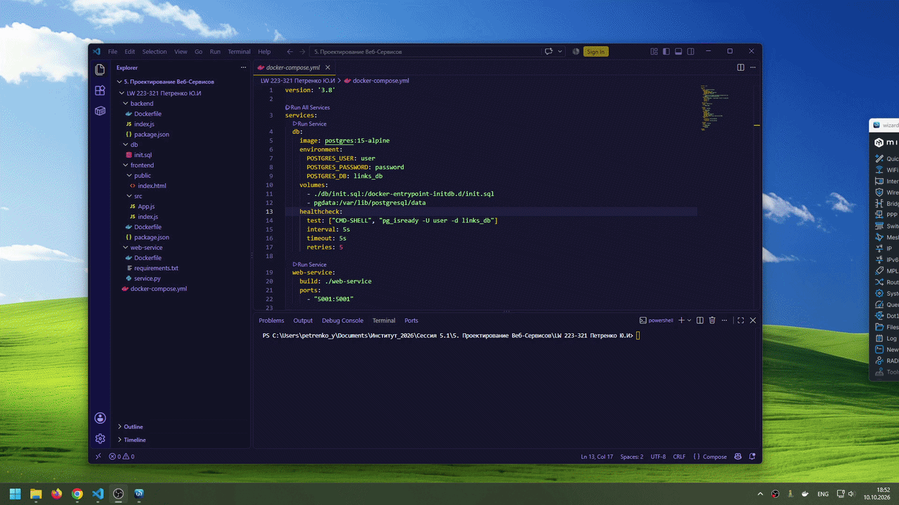

# Лабораторная работа: Контейнеризация многокомпонентных приложений с помощью Docker Compose

**Студент:** Петренко Ю.И.  
**Дисциплина:** Проектирование Веб-Сервисов  
**Вариант №8:** Сокращение ссылок

## 🎬 Результат работы программы

Ниже показан полный цикл работы сервиса: ввод длинной ссылки, получение короткой, переход по ней и подтверждение редиректа.


---

## 📋 Описание

Многокомпонентное веб-приложение для сокращения длинных URL-адресов. Пользователь вводит длинную ссылку — сервис генерирует уникальный короткий код и возвращает готовую короткую ссылку. При переходе по короткой ссылке открывается страница подтверждения, откуда можно перейти на исходный ресурс.

## 🏗️ Архитектура

Приложение состоит из **4 независимых контейнеров**, объединённых в одну Docker-сеть:

| Компонент | Технология | Назначение |
|-----------|-----------|------------|
| **frontend** | React 18 | Пользовательский интерфейс, 2 функциональные кнопки |
| **backend** | Node.js + Express | REST API, CRUD-операции с БД, интеграция с Web-сервисом |
| **web-service** | Python + Flask | Микросервис генерации коротких кодов (вариант 8) |
| **db** | PostgreSQL 15 | Хранение соответствий «короткая ↔ длинная ссылка» |

## 🔄 Схема работы

1. Пользователь вводит длинную ссылку в поле на фронтенде.
2. Frontend отправляет `POST /api/shorten` на backend.
3. Backend обращается к **web-service** (`GET /generate`) за коротким кодом.
4. Backend сохраняет пару «оригинал + код» в **PostgreSQL**.
5. Frontend отображает готовую короткую ссылку вида `http://localhost:5000/{код}`.
6. При клике по короткой ссылке backend отдаёт страницу подтверждения перехода.

## 🚀 Запуск

### Требования

- Установленный [Docker Desktop](https://www.docker.com/products/docker-desktop/)
- Свободные порты: **3000**, **5000**, **5001**, **5432**

### Команда запуска

```bash
docker compose up --build
```

Для запуска в фоновом режиме:

```bash
docker compose up -d --build
```

После запуска открой в браузере: **http://localhost:3000**

### Остановка

```bash
docker compose down
```

Полная очистка (включая данные БД):

```bash
docker compose down -v
```

## 🖱️ Использование

1. **Кнопка «Сократить»** — введите длинную ссылку и нажмите кнопку. Появится новая запись с короткой ссылкой.
2. **Кнопка «Копировать»** — копирует короткую ссылку в буфер обмена.
3. **Кнопка «Обновить»** — перезагружает список ссылок из базы данных.
4. **Клик по короткой ссылке** — открывает страницу подтверждения перехода на оригинальный ресурс.

## 📁 Структура проекта

```
lab-docker-compose/
├── docker-compose.yml      # Оркестрация 4 контейнеров
├── README.md               # Этот файл
├── .gitignore              # Исключения для Git
├── backend/                # Node.js REST API
│   ├── Dockerfile
│   ├── package.json
│   └── index.js
├── frontend/               # React-приложение
│   ├── Dockerfile
│   ├── package.json
│   ├── public/
│   │   └── index.html
│   └── src/
│       ├── App.js
│       └── index.js
├── web-service/            # Python микросервис
│   ├── Dockerfile
│   ├── requirements.txt
│   └── service.py
└── db/
    └── init.sql            # Инициализация БД
```

## 🔧 Технические детали

- **Сеть:** стандартная bridge-сеть Docker Compose.
- **Healthcheck:** для контейнера `db` настроена проверка готовности через `pg_isready`.
- **depends_on:** backend запускается после готовности БД и старта web-service.
- **Volume:** `pgdata` сохраняет данные PostgreSQL между перезапусками.
- **Переменные окружения:** параметры подключения к БД и адрес web-service передаются через `environment`.
- **Инициализация БД:** при первом запуске автоматически выполняется `db/init.sql`.

## 📝 API

| Метод | Путь | Описание |
|-------|------|----------|
| GET | `/api/links` | Получить все сокращённые ссылки |
| POST | `/api/shorten` | Сократить новую ссылку |
| GET | `/:shortCode` | Перейти по короткой ссылке (страница подтверждения) |

## 📄 Лицензия

Учебный проект. Свободное использование в образовательных целях.